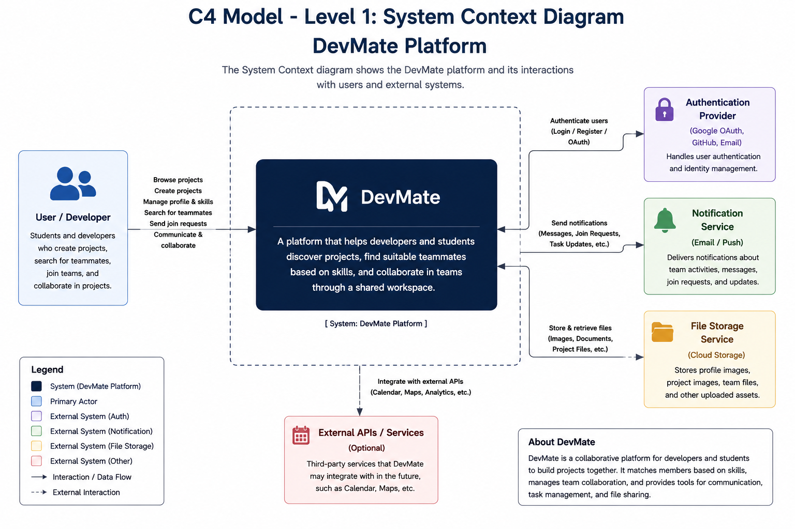
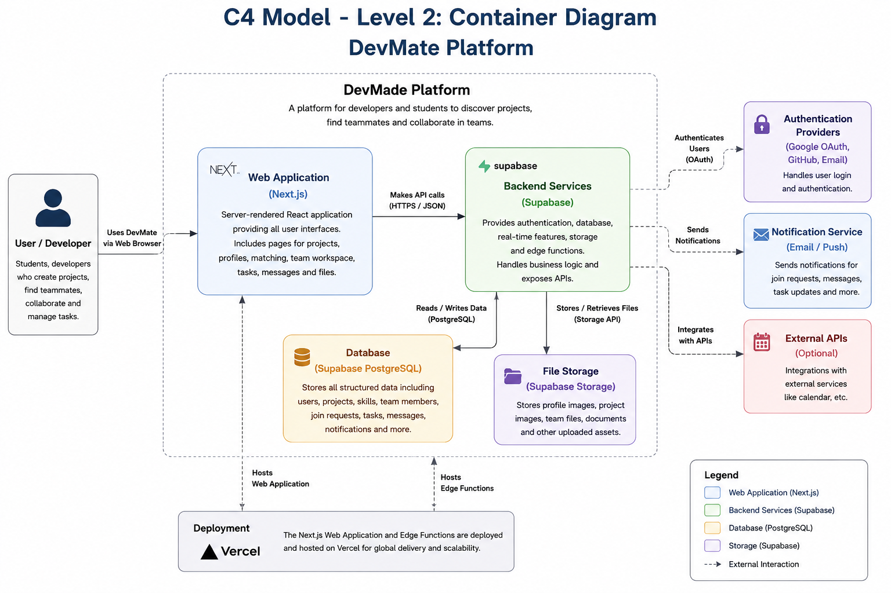

(สำหรับใส่ UML, Data Design, และแผนภาพระบบ)
# 📐 Architecture & UML Diagrams 
ให้นิสิตวางแผนภาพ Use Case, Class Diagram และสถาปัตยกรรมระบบที่นี่
## C4 Model Diagrams

### Level 1: System Context Diagram

### Level 2: Container Diagram
