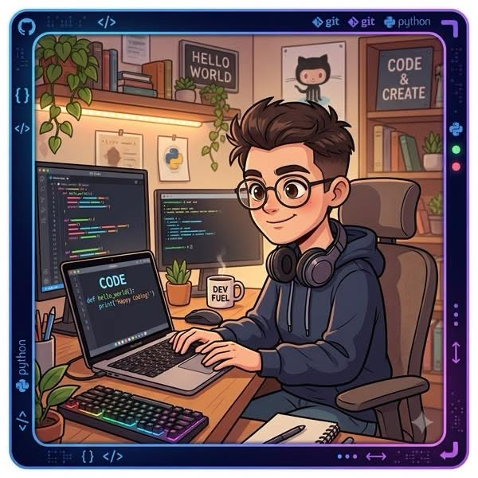

# 👤 Persona 1: Project Creator

**ชื่อ:** กิตติพัฒน์ ยศวงค์
**อายุ:** 21 ปี (นิสิตปี 2)
**บทบาท (Role):** ผู้สร้างโพสต์โปรเจกต์และเป็นผู้กำหนดคุณลักษณะทีม

## 1️⃣ Background (ข้อมูลทั่วไป)
* เรียนสาขาวิศวกรรมซอฟต์แวร์ มีความสนใจในการพัฒนาแอปพลิเคชันเชิงโซลูชันเพื่อแก้ปัญหาภายในมหาวิทยาลัย
* มีไอเดียโปรเจกต์ "DevMate" อยู่แล้ว แต่ยังไม่มีเพื่อนร่วมทีมที่มีทักษะ Backend / UI-UX เพียงพอ
* คุ้นเคยกับเครื่องมือจัดการโปรเจกต์แบบ Agile (Scrum, Kanban) แต่ยังไม่มีระบบอัตโนมัติในการจับคู่คนที่มีสกิลตรงกับความต้องการ

## 2️⃣ Goals (เป้าหมาย)

| # | Goal | Metric (How to measure) |
| :--- | :--- | :--- |
| 1 | สร้างโปรเจกต์บน DevMate ได้ภายใน 5 นาที | เวลาที่ใช้จากคลิก "Create Project" -> "Publish" ≤ 5 min |
| 2 | ระบุทักษะที่ต้องการให้ระบบแสดงผู้ที่ตรงสกิลภายใน 10 วินาที | เวลา response API "Match Skills" ≤ 10 s |
| 3 | ได้รับการสมัครเข้าทีมจาก Skill Provider ≥ 3 คน ภายใน 48 ชม. หลังโพสต์ | จำนวน "Applications" ≥ 3 ใน 48 h |
| 4 | สามารถตรวจสอบโปรไฟล์ของผู้สมัคร (ประวัติการทำงาน, portfolio) ได้โดยไม่ต้องออกจากแอป | จำนวนขั้นตอน "View Profile" ≤ 2 คลิก |

## 3️⃣ Pain Points (ปัญหาที่พบเจอ)

| # | Pain Point | Impact |
| :--- | :--- | :--- |
| 1 | ต้องคัดกรองผู้สมัครด้วยตนเองในหลายแอป (LINE, Google Sheet) | เสียเวลา 30-60 min / โปรเจกต์ |
| 2 | ไม่สามารถระบุ "Skill Gap" ของทีมได้อย่างชัดเจน | ทำให้ทีมอาจขาดบุคลากรสำคัญ |
| 3 | ไม่แน่ใจว่าผู้สมัครมีความพร้อมทางเทคนิคจริงหรือเป็น "AI-generated résumé" | ความเสี่ยงต่อคุณภาพของงาน |
| 4 | การสื่อสารและจัดการการนัดพบทีมทำงานกระจัดกระจาย | ประสิทธิภาพการทำงานลดลง 20-30% |

## 4️⃣ How DevMate Helps (แอปช่วยแก้ปัญหาได้อย่างไร)

| Feature | How it solves the pain point | Success criteria |
| :--- | :--- | :--- |
| **Smart Skill-Match Engine** | กิตติพัฒน์กรอก "ต้องการ: Backend (Node.js, Python) + UI/UX (Figma)" ระบบใช้เทคนิค vector similarity ระหว่างคีย์เวิร์ดสกิลของผู้ใช้กับความต้องการ -> แสดงรายชื่อผู้ที่ตรงและระดับความแม่นยำ (score) | ความแม่นยำของ Match ≥ 80% (validated by อัตราการรับงานจริง) |
| **One-Click Project Posting** | ฟอร์มกรอกข้อมูลหลัก (ชื่อโปรเจกต์, คำอธิบาย, สกิลที่ต้องการ, ระยะเวลา) -> สร้างโพสต์โดยอัตโนมัติใน 3 ขั้นตอน | เวลาโพสต์ ≤ 5 min |
| **Verified Portfolio Link** | ผู้สมัครเชื่อมต่อ GitHub / Behance -> ระบบดึงสถิติ commit, PR, หรืองานออกแบบที่เกี่ยวข้อง ทำให้กิตติพัฒน์เห็นผลงานจริงโดยไม่ต้องออกจากแอป | 100% ของผู้สมัครที่เชื่อมต่อได้แสดงสถิติครบ |

## 5 ความถี่การใช้งาน 

ใช้งานประมาณ 2–3 ครั้งต่อสัปดาห์ โดยเฉพาะในช่วงสร้างโปรเจกต์ ค้นหาสมาชิก และตรวจสอบผู้สมัครเข้าทีม