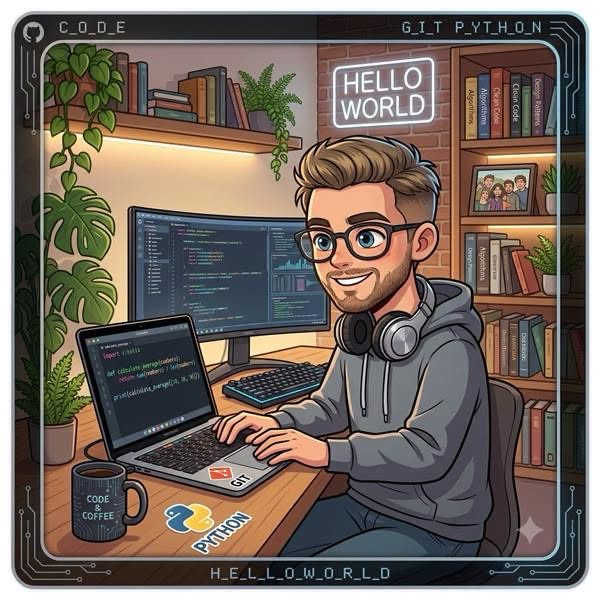

# 👤 Persona 2: Skill Provider

**ชื่อ:** สิรภัทร วิเวกหัสกัณฑ์
**อายุ:** 22 ปี (นิสิตปี 3)
**บทบาท (Role):** ผู้มีทักษะเฉพาะทางที่กำลังมองหาโครงการที่ตรงกับความสนใจและพัฒนาพอร์ตโฟลิโอ

## 1️⃣ Background (ข้อมูลทั่วไป)
* มีความชำนาญด้าน Frontend (React, Vue.js) และ UI Design แต่ยังไม่มีโอกาสทำงานร่วมกับ Backend จริง
* ต้องการประสบการณ์ทำโปรเจกต์เต็มรูปแบบเพื่อเพิ่มน้ำหนักในพอร์ตโฟลิโอก่อนจบการศึกษา
* เคยใช้เว็บบอร์ดและกลุ่ม Facebook เพื่อหาทีม แต่พบว่าไม่ได้กรองตามคุณภาพสกิลหรือเป้าหมายของโปรเจกต์

## 2️⃣ Goals (เป้าหมาย)

| # | Goal | Metric (How to measure) |
| :--- | :--- | :--- |
| 1 | ค้นหาโปรเจกต์ที่ต้องการ Frontend ภายใน 3 นาที | เวลา "Search -> Result" ≤ 180 s |
| 2 | ตรวจสอบว่าโปรเจกต์มีความสมบูรณ์ (spec, timeline) ก่อนสมัคร | 80% ของโปรเจกต์ที่ดูมี "Project Details" ครบ |
| 3 | สมัครเข้าทีมและได้รับการตอบรับภายใน 24 ชม. | "Application -> Acceptance" ≤ 24 h |
| 4 | เพิ่มคะแนนพอร์ตโฟลิโอ (GitHub stars / UI showcase) อย่างน้อย 1 ครั้งต่อโปรเจกต์ | จำนวน "Portfolio Updates" ≥ 1 ต่อโปรเจกต์ |

## 3️⃣ Pain Points (ปัญหาที่พบเจอ)

| # | Pain Point | Impact |
| :--- | :--- | :--- |
| 1 | โพสต์โปรเจกต์หลายที่ไม่มีข้อมูลสกิลที่ต้องการชัดเจน | สูญเสียเวลาในการคัดกรอง |
| 2 | ความกังวลว่าโปรเจกต์อาจไม่มีความต่อเนื่องหรือยุติเร็ว | เสี่ยงเสียโอกาสพัฒนาทักษะ |
| 3 | ไม่มีระบบ "match score" ทำให้ต้องลองหลายโปรเจกต์จนเจอคนที่เหมาะ | ใช้เวลา 2-3 ชม. ต่อการค้นหา |
| 4 | การสื่อสารกับผู้สร้างโปรเจกต์มักกระจัดกระจาย (LINE, Email) | ทำให้ความเข้าใจขอบเขตงานคลาดเคลื่อน |

## 4️⃣ How DevMate Helps (แอปช่วยแก้ปัญหาได้อย่างไร)

| Feature | How it solves the pain point | Success criteria |
| :--- | :--- | :--- |
| **Skill-Based Project Search** | ฟิลเตอร์ตามสกิลที่ผู้ใช้กำหนด (Frontend, React) -> แสดงโปรเจกต์ที่ต้องการสกิลนั้นพร้อม "Match Score" | 90% ของผลลัพธ์ตรงกับสกิลที่ระบุ |
| **Project Transparency Dashboard** | แสดงข้อมูลเชิงลึกของโปรเจกต์ (timeline, milestones, tech stack, ทีมที่มีอยู่) | 95% ของโปรเจกต์มีข้อมูลครบถ้วน |
| **One-Click Apply + Auto-Intro** | สร้างข้อความแนะนำอัตโนมัติ (รวม portfolio link) -> ส่งไปยังผู้สร้างโดยตรง | เวลา Apply ≤ 30 s |
| **Integrated Chat + Calendar** | เริ่มสนทนาในแอป, ตั้งเวลา Zoom/Google Meet ผ่านปุ่มเดียว | จำนวน "Meetings scheduled" ≥ 80% ของการสมัครที่รับ |

## 5 ความถี่การใช้งาน 
ใช้งาน DevMate ประมาณ 3–5 ครั้งต่อสัปดาห์ โดยใช้สำหรับค้นหาโปรเจกต์ที่ตรงกับทักษะ Frontend และ UI Design ตรวจสอบรายละเอียดโปรเจกต์ สมัครเข้าทีม ติดตามสถานะการสมัคร และติดต่อสื่อสารกับผู้สร้างโปรเจกต์